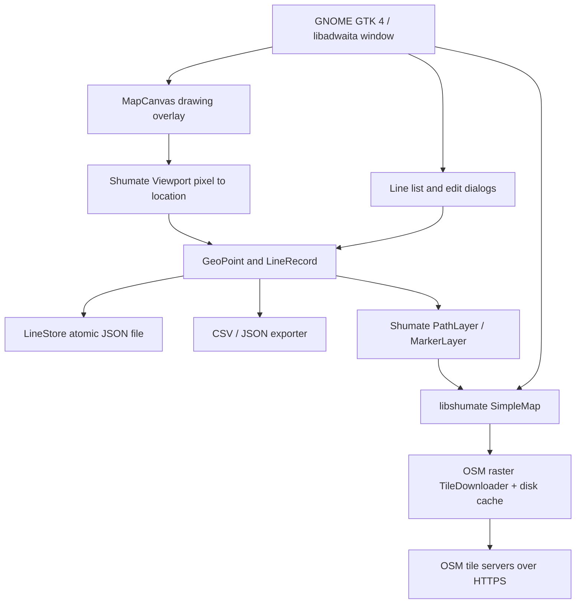

# Architecture

## Objective

Create a native GTK GNOME app which annotates line endpoints accurately on an OSM backdrop, persists labelled line pairs without a backend, and exports interoperable WGS84 coordinates.

## Logical components



## Modules

| Module | Responsibility | External dependency |
|---|---|---|
| `constants.py` | Identifier, initial camera and tile config | None |
| `models.py` | Validate coordinates and records, estimate distance | Python standard library |
| `storage.py` | XDG location, JSON deserialization, atomic writes | Python standard library |
| `exporters.py` | CSV/JSON interoperable serialisation and formula protection | Python standard library |
| `ui.py` | App, map, drawing state machine, dialogs, overlays, user actions | PyGObject, GTK4, Adw, Shumate |
| `__main__.py` | Application entrypoint | `ui.py` |

## Map rendering and pointer transformation

1. `Shumate.RasterRenderer` draws OSM Standard raster tiles using a `Shumate.TileDownloader` and its built-in filesystem cache.
2. `Shumate.SimpleMap` manages interaction, viewport centre and zoom; its reference map source uses Web Mercator.
3. A `Gtk.Overlay` holds a transparent `MapCanvas` above `SimpleMap`. With draw mode off, `set_can_target(False)` permits ordinary map panning and wheel zoom. With draw mode on, the canvas takes mouse input.
4. The capture path calls `Gtk.Widget.translate_coordinates` to map canvas-local screen coordinates to the nested Shumate map widget.
5. `Shumate.Viewport.widget_coords_to_location(map_widget, x, y)` converts the true map pixel to geographic latitude/longitude using the map's current viewport, zoom and projection. This avoids ad-hoc approximations or hardcoded map dimensions.
6. A completed line becomes two validated `GeoPoint` objects and an immutable `LineRecord`.
7. `Shumate.PathLayer` reprojects persisted latitude/longitude on every viewport change; endpoint markers are attached to the selected record.

## Line drawing state machine

```text
NAVIGATE
    | Draw line
    v
DRAW_READY -- press/release (<5px) --> START_CHOSEN
    |                                     | second click or drag
    | press/drag/release (>=5px)           v
    +-------------------------> EDIT_NEW_LINE
                                         | save
                                         v
                                     NAVIGATE
                                         | cancel
                                         v
                                     NAVIGATE
```

Note that releasing on the same coordinate as start is rejected. Cancellation leaves no partial record. A line is saved only after successful label and coordinate validation and an atomic write.

## Storage and data integrity

- Filesystem: `$XDG_DATA_HOME/gps-line-studio/lines.json` or `~/.local/share/gps-line-studio/lines.json`.
- Format: versioned JSON schema (`schema_version: 1`) containing `LineRecord` values.
- Save: create private temporary file (`0600`) in the destination directory, flush, `fsync`, then `os.replace` to avoid partially written records during process interruption.
- On corrupt or unsupported data, startup fails with a terminal error rather than silently resetting user records.
- Records have UUIDv4 ID and ISO-8601 UTC creation timestamp. Edits preserve both.
- Tiles are cached independently by libshumate; their cache must not be archived as an offline OSM tile download product.
- No remote user accounts, database, backend or telemetry; the only network requests are map tiles.

## Coordinate accuracy

- **Reference system:** WGS84 geographic latitude/longitude, labelled `EPSG:4326`. Display and CSV use nine digits after the decimal; JSON retains the stored binary double precision values.
- **Display-to-geography:** computed from viewport projection, not rounded tile centre.
- **Effective pointing resolution:** bound by cursor position, scaling, map zoom, mouse device, raster tile resolution and actual OSM feature accuracy.
- **Distance:** spherical haversine with mean Earth radius 6,371,008.8 m, reported as an **approximate straight-line distance**. Not terrain, survey-grade geodesic or routing distance.
- **No inferred centre waypoint:** only user-selected start and end are stored for each segment.

At latitude ~54.17°, nominal ground distance per CSS pixel at z19 is approximately `156543.0339 × cos(latitude) / 2^19 ≈ 0.175 m`, before display-scaling effects. Nine decimal digits (~0.1 mm representational resolution in latitude) are *not* 0.1 mm measurement accuracy.

## OpenStreetMap compliance

- Tiles from `https://tile.openstreetmap.org/{z}/{x}/{y}.png` over TLS.
- `Shumate.set_user_agent()` sets an application-specific identifier before creating the downloader.
- `SimpleMap` reads the copyright text and URL from the map source, and a permanent explicit footer displays © OpenStreetMap contributors.
- libshumate TileDownloader has an on-disk cache, avoiding unnecessary repeated downloads.
- No bulk prefetch or offline-tile download functionality.
- Before redistributing at scale, use an appropriate tile service and a real contact URL in `USER_AGENT`, and verify cached tile expiry policies.

Policy reference: https://operations.osmfoundation.org/policies/tiles/

## Security and privacy boundaries

- Local files only; no embedded browser content or third-party JavaScript.
- Coordinate values and label lengths are validated. CSV label prefixes that could be interpreted as formulas are neutralised.
- Save errors do not mutate in-memory store; corrupted input blocks automatic overwrites.
- OSM sees the requested map tiles (approximate viewport and provider-visible metadata); it does **not** receive stored line labels or exported files.
- Local user access to saved data is governed by desktop account permissions and filesystem controls.

## Extension points

- Add polyline routing and OSRM/GraphHopper integration separately; do not present straight lines as road routes.
- Support OSM vector tiles or a custom tile provider respecting attribution.
- Add local data import, reversible undo/redo, GeoJSON or GPX export, coordinate search/geocoding, GNSS hardware input and optional editing of endpoints by dragging markers.
